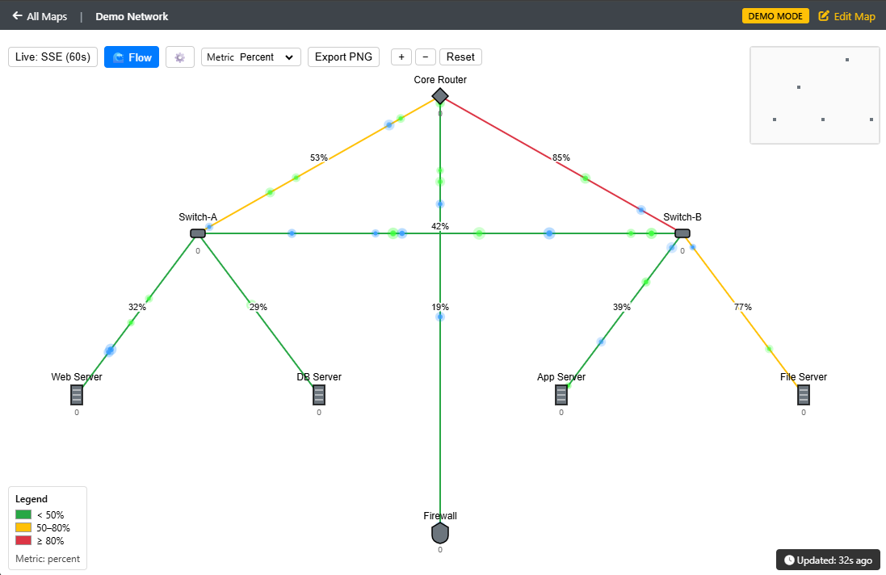
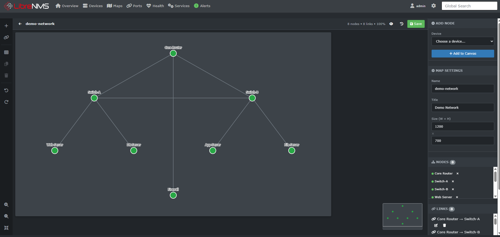

# WeathermapNG

<p align="center">
  
</p>

**Network weathermap plugin for LibreNMS — real-time topology visualization with animated traffic flow.**

WeathermapNG renders your LibreNMS topology as live weathermaps: RRD-backed
per-link traffic, CPU/memory overlays, alert badges, and an embeddable viewer
with Server-Sent Events. Design maps in a 3-panel editor with undo/redo,
auto-discovery from LLDP/CDP, templates, versioning, and bulk operations.

[Documentation](docs/README.md) · [Install](#install) ·
[Releases](https://github.com/lance0/weathermapNG/releases) · [Changelog](CHANGELOG.md)


## Install

```bash
cd /opt/librenms/html/plugins
git clone https://github.com/lance0/weathermapNG.git WeathermapNG
sudo chown -R librenms:librenms /opt/librenms/html/plugins/WeathermapNG
sudo -u librenms -H bash -lc 'cd /opt/librenms/html/plugins/WeathermapNG && ./quick-install.sh'
```

The script installs dependencies, registers the Composer package with LibreNMS, sets up database tables, and enables the plugin. Run it as the `librenms` user — running as root can leave root-owned Composer files behind. `just install LIBRENMS_PATH=/opt/librenms` runs the same flow as a thin wrapper.

If routes don't appear after install:

```bash
cd /opt/librenms
php artisan route:list | grep -iE 'weathermap|wmng'
composer config repositories.weathermapng '{"type":"path","url":"html/plugins/WeathermapNG","options":{"symlink":true}}'
FORCE=1 composer require 'librenms/weathermapng:*' --with-dependencies --no-interaction
php artisan package:discover
php artisan optimize:clear
```

After install, open `https://your-librenms/plugin/WeathermapNG` and create your first map. Docker-based install for development and testing, demo mode, permissions, and troubleshooting: [installation guide](docs/INSTALL.md).

## What it does

- **Live traffic weathermaps**: RRD-based bandwidth per link, animated flow, percent/in/out/sum metrics
- **CPU & memory overlay**: per-node utilization with warning thresholds
- **Alert integration**: severity-colored badges with click-through to LibreNMS alerts
- **Nested maps / drill-down**: click a summary node to navigate to a detailed sub-map (campus → building → rack); breadcrumb bar tracks the hierarchy
- **3-panel editor**: toolbox, canvas, properties — undo/redo, grid snap, zoom/pan/minimap, keyboard shortcuts
- **Bulk operations**: marquee multi-select, group drag, bulk delete with undo
- **LLDP/CDP auto-discovery**: seed topology from LibreNMS neighbor data
- **Templates, tags & per-map styles**: built-in Data Center, WAN/MPLS, Campus, and Branch Office topologies; tag filtering; default node/link styling
- **Legacy Weathermap import**: read PHP Weathermap-style `.conf` files (round-trip export included)
- **Map versioning**: snapshot, history, restore, compare, delete
- **Embed viewer**: iframes, kiosk/NOC wall with map cycling, RRD graph hover
- **Accessibility**: ARIA labels on icon-only controls, keyboard focus visibility, form labels
- **Render diagnostics**: `?debugDots=1` overlays particle positions; `?debugDots=2` adds a full render-pipeline panel
- **Import/export**: JSON round-trip for backup and sharing
- **Admin-only mutations**: all write endpoints require admin; reads are open to authenticated users

<p align="center">
  
</p>

## Tasks

| Task | Guide |
|------|-------|
| Install, update, or troubleshoot | [Installation](docs/INSTALL.md) · [Updating](#updating) · [Deployment](docs/DEPLOYMENT.md) |
| Embed a map or run a NOC wall | [Embed Viewer](docs/EMBED.md) |
| Call a route or script against the API | [API reference](docs/API.md) |
| Tune large-map performance | [Performance notes](docs/PERFORMANCE.md) |
| Diagnose a broken install | [API: probes & diagnostics](docs/API.md#health-and-metrics-routes) |
| Contribute or run tests | [Contributing](CONTRIBUTING.md) · [Roadmap](ROADMAP.md) |
| Cut a release | [Release process](RELEASE.md) · [Versioning](docs/VERSIONING.md) |

## Updating

```bash
cd /opt/librenms/html/plugins/WeathermapNG
git pull
composer install --no-dev --optimize-autoloader
php database/setup.php
cd /opt/librenms
FORCE=1 composer require 'librenms/weathermapng:*' --with-dependencies --no-interaction
php artisan package:discover
php artisan optimize:clear
php artisan route:list | grep -iE 'weathermap|wmng'
```

Upgrade safety notes (schema, config, and plugin-row normalization) are in the
[installation guide](docs/INSTALL.md#updating).

## License

MIT License — see [LICENSE](LICENSE)
