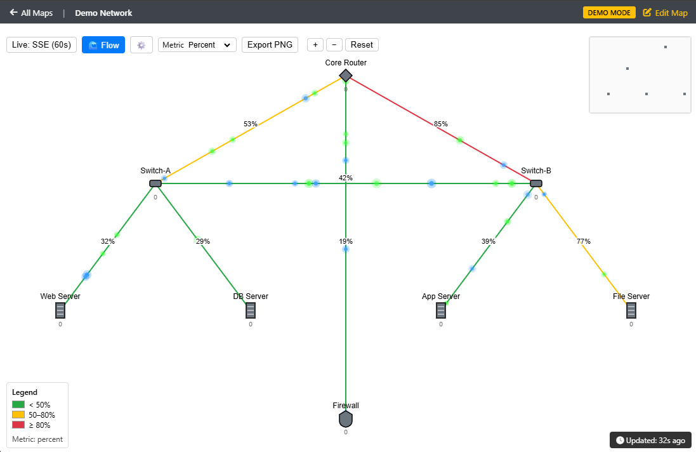
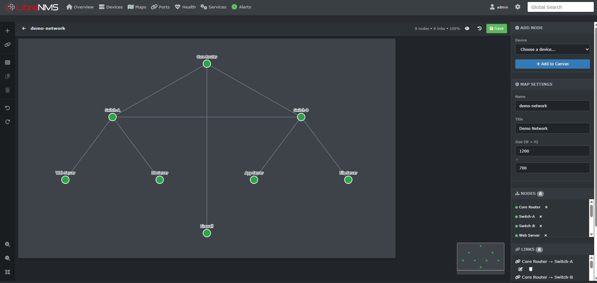

<p align="center">
  
</p>

# WeathermapNG

Network weathermap plugin for LibreNMS. It renders the topology LibreNMS already
knows as a live map: per-link traffic from RRD files, CPU/memory overlays, alert
badges, and an embeddable viewer for dashboards and NOC walls. Maps are built in
a 3-panel editor with undo/redo, LLDP/CDP auto-discovery, templates, version
history, and multi-select bulk edits.

[Documentation](docs/README.md) · [Install](#quick-start) ·
[Releases](https://github.com/lance0/weathermapNG/releases) ·
[Known issues](KNOWN_ISSUES.md) · [Security](SECURITY.md) ·
[Changelog](CHANGELOG.md)


## Quick start

Run this as the LibreNMS runtime user. The parent plugin directory must already
permit that user to create the checkout.

```bash
sudo -u librenms -H bash
export LIBRENMS_PATH=/opt/librenms
cd "$LIBRENMS_PATH/html/plugins"
git clone --branch v1.17.0 --depth 1 https://github.com/lance0/weathermapNG.git WeathermapNG
cd WeathermapNG
./quick-install.sh
php verify-deployment.php --json
exit
```

The installer installs dependencies, applies schema changes, clears caches, and
registers the plugin with these two commands:

```bash
composer config --global repositories.weathermapng /path/to/WeathermapNG
lnms plugin:add librenms/weathermapng
```

The final read-only `verify-deployment.php` report checks what LibreNMS
actually registered. Log in to LibreNMS afterwards and open
`/plugin/WeathermapNG`; an empty index offers **Create Sample Map** for a
device-free example.

Docker, packaged installs, upgrades, and recovery are covered in the
[installation guide](docs/INSTALL.md).

<p align="center">
  
</p>

## What you get

- **Live traffic**: RRD-backed bandwidth per link with animated flow,
  percent/in/out/sum metrics, CPU/memory overlays, severity-colored alert
  badges, and RRD graph hover on nodes and links.
- **Editor**: 3-panel toolbox, canvas, and properties layout with undo/redo,
  grid snap, zoom/pan/minimap, and keyboard shortcuts. Per-node style overrides
  (fill, label color, shape, size) apply to a multi-selection, and icon-only
  controls carry ARIA labels.
- **Bulk editing**: marquee multi-select, Ctrl/Cmd+A select-all, group drag,
  and bulk delete or style apply with undo.
- **Navigation**: nested maps with click-through drill-down and breadcrumbs,
  per-user favorites with an index filter, and tag filtering.
- **Authoring**: LLDP/CDP auto-discovery from LibreNMS topology data, the
  built-in Data Center, WAN / MPLS, Campus Network, and Branch Office
  templates, legacy PHP Weathermap `.conf` import, and JSON import/export.
- **Versioning**: snapshot, history, restore, compare, and delete for each map.
- **Embedding**: iframe viewer with query parameters, kiosk/NOC wall mode with
  map cycling, SSE or polling updates, and PNG or static SVG export.
- **Operations**: public health, readiness, and liveness probes, an admin
  diagnostics page, and render debug overlays.

Reads are open to any authenticated LibreNMS user. Every mutation requires an
administrator, except toggling your own favorite.

## Tasks

| Task | Guide |
|------|-------|
| Install, upgrade, or recover | [Installation](docs/INSTALL.md) · [Updating](#updating) |
| Embed a map or run a NOC wall | [Embed viewer](docs/EMBED.md) |
| Call a route from a script | [API reference](docs/API.md) |
| Check production readiness | [Deployment](docs/DEPLOYMENT.md) · [Diagnostics](docs/INSTALL.md#diagnostics-and-targeted-recovery) |
| Tune large maps | [Performance notes](docs/PERFORMANCE.md) |
| Contribute or run tests | [Contributing](CONTRIBUTING.md) · [Roadmap](ROADMAP.md) |
| Cut a release | [Release process](RELEASE.md) · [Versioning](docs/VERSIONING.md) |

## Requirements and compatibility

| Component | Requirement |
|-----------|-------------|
| PHP | 8.2+ with `gd`, `json`, `pdo`, and `mbstring` |
| LibreNMS | Latest stable. v1.17.0 is tested against LibreNMS 26.10.2 |
| Database | MySQL or MariaDB, as installed by LibreNMS |
| Composer | Usable by the runtime user; plugin registration uses the `lnms` CLI |
| RRD data | RRD files readable by the runtime user |
| Host | Linux `flock` (util-linux) for installer locking; checkout writable by the runtime user |

Newer LibreNMS releases can raise the PHP minimum above 8.2. Follow the
requirement of the LibreNMS version you run. CI covers PHP 8.2, 8.3, and 8.4
against a LibreNMS Docker image.

## Documentation

The [documentation index](docs/README.md) maps every page, or start directly at
the task above. Main pages:

| Page | Scope |
|------|-------|
| [Installation](docs/INSTALL.md) | Native and Docker install, configuration, upgrades, diagnostics, backup and recovery. |
| [API](docs/API.md) | Every route with method, auth tier, and payload shape. |
| [Embed viewer](docs/EMBED.md) | Iframe parameters, kiosk mode, token auth, export. |
| [Deployment](docs/DEPLOYMENT.md) | Probes, verification checklist, optional poller, security notes, compatibility. |
| [Performance](docs/PERFORMANCE.md) | Caching, render costs, suggested map budgets, profiling checklist. |
| [Versioning](docs/VERSIONING.md) | SemVer rules, version sources, map version history. |

## Updating

A LibreNMS update and a plugin upgrade are separate operations. Back up the
database and configuration first, select the intended release, then follow
[the upgrade procedure](docs/INSTALL.md#updating). The same procedure covers
Docker deployments and archive-based installs.

## License

MIT License — see [LICENSE](LICENSE)
